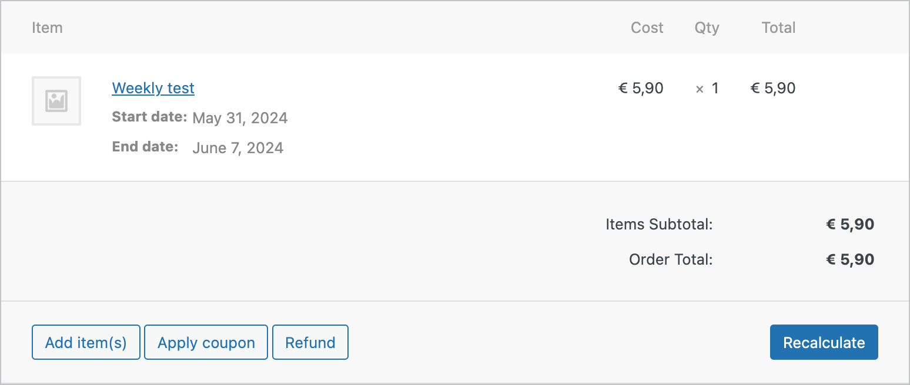
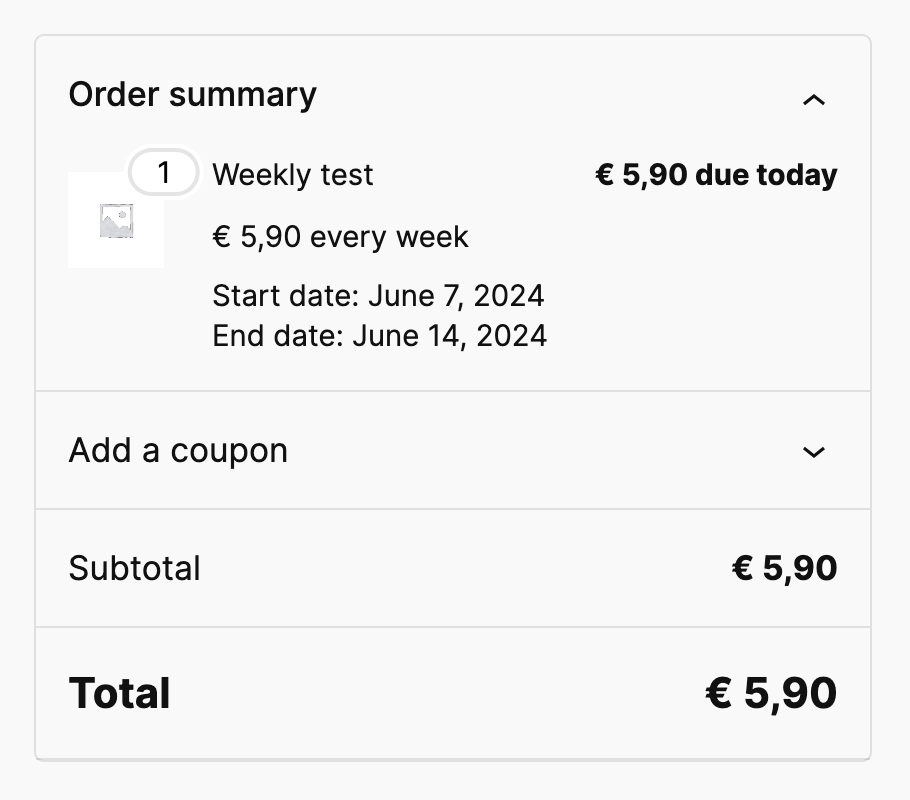

# Pronamic period information for Woo Subscriptions

This “Woo Subscriptions” add-on ensures that a period is saved with each subscription order. The “Woo Subscriptions” plugin itself does not store the subscription period in an order. Without this add-on, it is not clear to webshop owners and customers for what period the subscription order and associated payment was.

## Table of contents

- [Order item meta](#order-item-meta)
- [Usage](#usage)
- [Screenshots](#screenshots)
- [Tested flows](#tested-flows)
- [Accounting programs](#accounting-programs)
  - [Moneybird](#moneybird)
- [Requirements](#requirements)
- [Development](#development)
- [Links](#links)

## Order item meta

Period is stored in the following order item meta:

| Key                    | Description.       |
| ---------------------- | ------------------ |
| `_pronamic_start_date` | Period start date. |
| `_pronamic_end_date`   | Period end date.   |

## Usage

```php
$orders = \wc_get_orders(
	[
		'status'  => [
			'wc-completed',
			'wc-refunded',
		],
		'type'    => 'shop_order',
		'limit'   => 10,
		'orderby' => 'date',
		'order'   => 'ASC',
	]
);

foreach ( $orders as $order ) {
	echo 'Order: ', $order->get_id(), PHP_EOL;

	foreach ( $order->get_items() as $item ) {
		echo '- Start date: ', $item->get_meta( '_pronamic_start_date' ), PHP_EOL;
		echo '- End date: ', $item->get_meta( '_pronamic_end_date' ), PHP_EOL;
	}
}
```

## Screenshots

### WordPress admin dashboard



_Screenshot of the WooCommerce order detail page in the WordPress admin dashboard with the period visible per item._

### WooCommerce checkout page



_Screenshot of the WooCommerce checkout page where a customer manually renews a subscription (early) and the period is visible._

## Tested flows

1. Frontend: My account → My Subscription → Actions → Renew now
2. Background: Automatic renewal order via the Action Scheduler library.
3. Backend: WooCommerce → Subscriptions → Edit Subscription → Order actions → Create pending renewal order

## Accounting programs

Certain accounting programs offer the option to define a period for invoice lines. In this way, an accounting program can automatically distribute the amounts over a period. This can be used for “Prepaid expenses” and “Deferred revenue” on the balance sheet.

### Moneybird

Moneybird is an accounting program with the option to set a period per invoice line:

- https://help.moneybird.nl/support/solutions/articles/103000075937-periodeselectie-op-je-facturen
- https://www.moneybird.nl/blog/191-moneybird-preview-je-volledige-boekhouding-in-moneybird

This plugin can make it easier to connect WooCommerce Subscriptions orders to your accounting in Moneybird.

## Requirements

- PHP 8.3+
- WordPress 6.7+
- WooCommerce
- Woo Subscriptions

## Development

This plugin follows the [SolveBeam WordPress Plugin Boilerplate](https://github.com/solvebeam/solvebeam-wordpress-plugin-boilerplate) conventions.

```sh
composer install
npm install
```

### Local environment (wp-env)

```sh
npx wp-env start
npx wp-env stop
```

| Mount path | Source | Purpose |
| --- | --- | --- |
| `wp-content/plugins/pronamic-woocommerce-subscriptions-period-dev` | `./` | Live development (including dev files) |
| `wp-content/plugins/pronamic-woocommerce-subscriptions-period` | `./build/pronamic-woocommerce-subscriptions-period/` | Built distribution version |

### Build

```sh
composer run build
```

Copies the plugin (respecting `.distignore`) to `build/`, installs production-only Composer dependencies, generates the translation files and creates a distributable ZIP.

### Translations

```sh
composer run make-pot
```

### Linting & analysis

```sh
composer run phpcs
composer run phpstan
composer run rector
```

## Links

- https://github.com/pronamic/woocommerce-subscriptions
- https://github.com/Automattic/woocommerce-subscriptions-core/
- https://github.com/pronamic/woocommerce-subscriptions/issues/10
